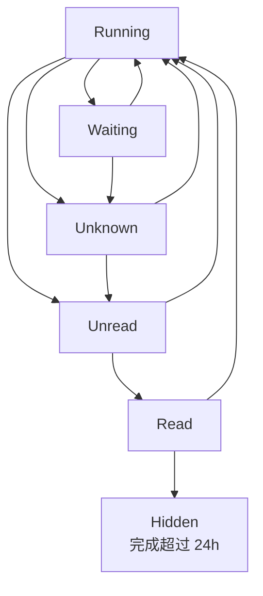

# Coding Agent Dashboard — 完整聊天记录

> 日期：2026-10-21  
> 范围：本次对话中关于 Codex CLI / Cursor Agent 监控工具的用户消息与助手正式回复，按原始顺序整理。  
> 说明：保留原问题、选项、用户选择及最终 PRD；不包含系统/开发者指令、工具调用日志和临时进度提示。对话最后附上本次文件导出请求。原回答中个别来源引用以其原始标记形式保留，可能无法在普通 Markdown 阅读器内解析。

---

## 第 1 轮

**用户：**

现在有没有 可以展示局域网内有ssh权限的codex cli，cursor agent进度的工具？
就是展示哪些agent在干活，哪些干完活了

**助手：**

有。截至 **2026 年 10 月 21 日**，已经有几款开源工具能实现类似需求。

你的需求本质是一个 **Coding Agent Monitoring Dashboard（编码智能体监控面板）**：

- 通过 SSH 访问局域网内的一台或多台开发机。
- 同时监控 Codex CLI 和 Cursor Agent。
- 展示哪些 Agent 正在执行、哪些等待用户操作、哪些已经完成。
- 最好不改变现有的开发方式，例如继续从 Cursor IDE、终端启动 Agent。

这里有个关键区别：**监控已经启动的 Agent，与通过管理工具启动并监控 Agent，是两种不同的能力。**

我筛选出了下面几个项目。

### 1. 工具对比

| 工具 | Codex CLI | Cursor Agent | 多台 SSH 主机 | 特点 |
|---|---|---|---|---|
| **SessionDeck** | ✅ | ✅ | ✅ | 最符合需求，监控已经启动的会话 |
| **Agent Deck** | ✅ | ✅ CLI | ✅ | TUI/Web 控制台，适合统一启动和管理 |
| **Claude Code Agent Monitor** | ✅ | ⚠️ | ✅ | Web 看板，SSH 远程 Cursor 支持不完整 |
| **codelight** | ✅ | ✅ | ⚠️ | 需要各主机运行监控服务，适合手机查看 |

#### 🥇 首选：SessionDeck

链接：https://github.com/len5ky/sessiondeck

这是最接近你描述的工具。

它直接读取已有 Agent 的会话记录和进程状态，不要求改用专门的 Agent 启动命令。

支持：
- Codex CLI：`codex`、`codex exec`
- Cursor CLI：`cursor-agent`
- Cursor IDE：Composer（需要启用对应监控）
- VS Code / Cursor 的 Remote-SSH 工作区
- 多主机状态聚合至一个侧边栏

它会展示这些状态：

| 状态 | 含义 |
|---|---|
| 🟢 Working | Agent 正在执行任务 |
| 🟣 Working | Agent 正在运行子 Agent |
| 🟡 Finished | 已完成，但尚未查看 |
| 🔵 Finished | 已完成并查看 |
| ⚪ Idle | 空闲 |

**特别注意：** Codex 和 Cursor 的等待审批状态不能被准确识别。它们可能显示为 Working 或 Idle；红色的等待输入通知目前主要针对 Claude Code。

项目通过读取会话日志、检查进程来判断状态，约每 3 秒刷新。<Cite refs={['turn216509view0','turn216509view1']}/>

**多机器使用方法**

在本地 Cursor 安装：

```bash
cursor --install-extension len5ky.sessiondeck
cursor --install-extension len5ky.sessiondeck-bridge
```

随后通过 Cursor Remote-SSH 连接开发机，并在每个远程工作区安装 SessionDeck 主扩展。Bridge 会合并这些远程工作区报告的状态。

注意，它不是自动扫描 `~/.ssh/config` 中所有机器的工具，需要先建立相应的 Remote-SSH 工作区连接。

**费用：** 前 3 天无限制，此后免费显示 3 个顶层会话；付费版目前标价一次性 $18.99 或 $5.99/月。它是源码可见的商业许可项目，不属于标准开源许可证。<Cite ref="turn216509view0"/>

#### 🥈 Agent Deck

链接：https://github.com/asheshgoplani/agent-deck

如果你愿意以后统一管理 Agent，Agent Deck 更有扩展空间。

它支持 Codex、Cursor Terminal 等工具，以及通过 SSH 管理远程主机上的 Agent Deck 实例。

```bash
agent-deck remote add dev user@192.168.1.20

agent-deck remote sessions
```

支持 TUI 和 Web Dashboard，也能聚合不同主机的会话状态。

但它主要管理 **由 Agent Deck 创建和维护的会话**，不是针对外部已启动会话设计的通用自动发现器。<Cite ref="turn214026view3"/>

#### 🥉 Claude Code Agent Monitor

链接：https://github.com/hoangsonww/Claude-Code-Agent-Monitor

如果你更喜欢浏览器中的 Kanban Dashboard，可以考虑它。

它具备 SSH Remote Data Sources，可以主动从远程 Linux 主机同步 Codex 会话数据，集中展示任务状态、时间线等信息。

**局限：** 当前通过 SSH 自动拉取的主要是 Claude Code 和 Codex 的数据；远程 Cursor 的原生数据目录尚未集成进这条 SSH 同步路径。<Cite ref="turn746311view2"/>

---

### 2. 我的建议

你现阶段只是想知道 **Agent 是否还在干活、是否已经结束**，没必要为了一个监控需求引入完整的 Agent Orchestrator。

**先试 SessionDeck。**

但还有一个关键架构选择：

**A.** 在本机 Cursor 中打开多个 Remote-SSH 工作区，接受安装轻量扩展，然后集中观察。

**B.** 不依赖 Cursor / VS Code，只给一个独立的 Web Dashboard 配置 SSH 主机列表，它就自动发现各台机器上已经运行的 Agent。

A 已经有相对直接的现成工具。B 对 Codex 有成熟度更高的实现，但同时完整覆盖远程 Cursor Agent 的方案，我还没有找到足够可靠的。

**你想要 A 还是 B？** 这个区别会直接影响最终的工具选择。

---

## 第 2 轮

**用户：**

我想做一个简单配置之后就可以继承 codex cli，cursor记录，按最新活跃项目(7天内)展示项目下的跨项目agent状态的web展示.
agent状态分为1.运行中, 2.完成待点开, 3.完成已点开[完成后点开，且已经过了一天(这种情况不展示].
活跃的项目排序:最近活跃的排在最先。
Help me set the scope for this project precisely. I want to brainstorm with you. 
​and understand how the tool should work. 
​Give me options.Ask me one question at a time and keep your output short.

**助手：**

建议先把项目定义为 **Coding Agent Activity Dashboard**。

核心原则：**只读监控、自动发现、不改变现有开发流程。**

### 初步 Scope（待确认）

- **接入**：配置 SSH 主机，自动发现 Codex / Cursor 会话。
- **项目**：只展示最近 7 天活跃的项目，按最后活跃时间倒序。
- **Agent 状态**：
  - 🟢 Running：执行中
  - 🟡 Unread：已完成，尚未点开
  - ⚪ Read：已完成且点开；完成超过 24 小时后隐藏
- **界面**：Web Dashboard → Project → Agent Sessions。
- **暂不包含**：启动 Agent、发送指令、修改任务。

### 问题 1：Cursor 的集成范围？

这是决定数据采集方案的关键。

**A.** 只支持 `cursor-agent` CLI

**B.** 只支持 Cursor IDE 内的 Agent / Composer

**C.** 两者都支持

我倾向于 **C**，但 IDE 会话记录的读取方式和状态识别准确性需要单独验证。

你选哪个？

---

## 第 3 轮

**用户：**

C

**助手：**

✅ 确定：同时支持 **Codex CLI、Cursor CLI、Cursor IDE Agent / Composer**。

### 问题 2：什么算「已点开」？

这决定 Unread → Read 的状态转换。

**A. Web 内点开（推荐）**
- 点击 Agent 卡片，展开任务详情。
- 自动标记为已读。
- 不需要操作原始 Agent。

**B. 原工具内点开**
- 必须在 Cursor / Codex 中查看会话。
- Web 自动同步已读状态。
- 实现复杂，且不一定能准确识别。

**C. 两者均可**
- Web 点击或原工具查看都算已读。

**我建议 A**，因为监控工具的已读状态可以独立管理，可靠性更高。

你选哪个？

---

## 第 4 轮

**用户：**

C

**助手：**

✅ 确定：**Web 和原始 Agent 工具内查看，都应触发已读。**

注意：Codex / Cursor 未必提供可靠的“用户已查看”事件，需要验证；无法检测时暂时保持未读。

### 问题 3：如何采集远程 Agent 状态？

**A. SSH Pull（推荐 MVP）**
- Web 服务通过 SSH 定期读取日志和进程。
- 远程机器无需安装软件。
- 部分状态可能只能推断。

**B. Lightweight Collector**
- 每台机器安装轻量采集器。
- 采集器主动上报状态。
- 实时性更好，但部署复杂。

**C. Hybrid**
- 默认 SSH Pull。
- 必要时安装采集器，提高准确性。

**我建议 A 起步，架构预留 C。**

你选哪个？

---

## 第 5 轮

**用户：**

A

**助手：**

✅ 确定：**SSH Pull**。

- Web 服务定期通过 SSH 扫描 Agent。
- 远程机器无需安装软件。
- 只读，不影响现有开发流程。
- 原工具内的已读状态保留为待验证能力。

### 问题 4：如何识别和归组项目？

**A. Git Repository（推荐）**
- 通过 Git 仓库识别项目。
- 不同机器上的同一个仓库合并展示。
- 非 Git 项目按工作目录识别。

**B. Working Directory**
- 直接按工作目录分组。
- 最简单，但不同机器上的同一项目可能被分开。

**C. 手动配置**
- 用户配置项目名称及对应目录。
- 最准确，但不符合零维护目标。

我建议 **A**，符合你的自动发现需求。

你选哪个？

---

## 第 6 轮

**用户：**

A

**助手：**

✅ 确定：**Git Repository 自动识别项目**。

- 相同 Git 仓库跨主机合并。
- 非 Git 项目按工作目录识别。
- 按最近 7 天活跃时间倒序展示。

### 问题 5：Agent 卡片的粒度？

Codex / Cursor 的同一个会话可以连续执行多轮任务。

**A. 按 Session 展示（推荐）**
- 每个会话一张卡片。
- 新任务开始 → Running。
- 当前任务结束 → Unread。
- 会话可以反复切换状态。

**B. 按 Task / Turn 展示**
- 每轮用户指令生成一张卡片。
- 保留每轮任务的独立完成状态。
- 卡片数量可能很多。

**C. 混合模式**
- 默认按 Session 展示。
- 点击后展开各轮任务及其状态。

我建议 **A**，最符合你快速了解哪些 Agent 正在工作的目标。

你选哪个？

---

## 第 7 轮

**用户：**

A

**助手：**

✅ 确定：**按 Session 展示，每个会话一张卡片**。

新任务开始时，原有 Session 可以重新进入 Running 状态。

### 问题 6：如何判断 Agent 正在运行？

例如：Codex 已经回答完毕，但终端仍然打开。

**A. 按任务执行状态（推荐）**
- 正在生成、调用工具 → Running
- 本轮任务执行结束 → Unread
- 即使 CLI 进程仍存在，也不算 Running

**B. 按进程状态**
- CLI 进程存在 → Running
- 进程退出 → Unread
- 无法准确区分工作与空闲

**建议 A**。通过会话日志中的开始、完成事件判断，而非进程是否存活。

你选哪个？

---

## 第 8 轮

**用户：**

A

**助手：**

✅ 确定：**Running 由任务执行状态决定，而非进程是否存活。**

- 任务执行中 → Running
- 本轮任务结束 → Unread
- CLI 进程仍在，但任务已结束 → Unread

### 问题 7：Agent 等待用户操作时如何展示？

例如 Codex 正在等待用户批准执行命令。

**A. 归入 Running**
- 显示 🟢 Running
- 附加 `Waiting for approval` 提示

**B. 增加 Waiting 状态（推荐）**
- 🟢 Running：正在执行
- 🟠 Waiting：等待用户操作
- 🟡 Unread：任务完成待查看
- ⚪ Read：任务完成已查看

**C. 归入 Unread**
- 认为 Agent 已停止工作，需要用户关注。

我建议 **B**，因为等待审批和正在执行是两种不同状态。但通过 SSH 读取日志，未必总能准确检测 Waiting。

你选哪个？

---

## 第 9 轮

**用户：**

B

**助手：**

✅ 确定：增加 **Waiting** 状态。

最终状态暂定：
- 🟢 Running：正在执行
- 🟠 Waiting：等待用户操作
- 🟡 Unread：任务完成，待查看
- ⚪ Read：任务完成，已查看

### 问题 8：已读 Session 何时隐藏？

**A. 完成时间 + 24 小时（推荐）**
- 已读且完成超过 24 小时 → 隐藏。
- 未读无论多久都保留（项目仍需满足 7 天活跃规则）。

**B. 阅读时间 + 24 小时**
- 已读后继续展示 24 小时。
- 随后隐藏。

**C. 阅读后立即隐藏**
- 点击查看后直接从 Dashboard 消失。

建议 **A**，符合你的原始描述，也避免已读内容长期占用空间。

你选哪个？

---

## 第 10 轮

**用户：**

A

**助手：**

✅ 确定：**已读且任务完成超过 24 小时后隐藏。**

未读任务不受 24 小时限制，但仍受项目 7 天活跃窗口约束。

### 问题 9：如何定义项目「活跃」？

**A. Agent 活动时间（推荐）**
- 最近一次 Agent 执行任务的时间。
- 不考虑 Git 提交或文件修改。

**B. 项目文件活动时间**
- 最近一次文件修改、Git 提交或 Agent 活动。
- 即使没有 Agent 工作，项目也可能排在前面。

**C. Agent + Git 活动**
- 综合 Agent 活动与 Git 提交时间。
- 信息更全面，但复杂度更高。

**建议 A**：Dashboard 的目标是监控 Agent，而不是项目开发活跃度。

你选哪个？

---

## 第 11 轮

**用户：**

A

**助手：**

✅ 确定：**项目活跃度只根据 Agent 活动时间计算。**

- 最近 7 天有 Agent 活动 → 展示项目。
- 按最后一次 Agent 活动时间倒序。
- 不考虑 Git 提交或文件修改。

### 问题 10：如何配置 SSH 主机？

**A. 复用 `~/.ssh/config`（推荐）**
- 选择需要监控的 Host。
- 自动复用 SSH Key、ProxyJump 等配置。
- 不需要重复管理 SSH 凭证。

**B. Web UI 添加主机**
- 在浏览器中填写 Host、User、SSH Key。
- 配置更直观，但需要管理凭证。

**C. 两者都支持**
- 默认读取 SSH Config。
- Web UI 可增删监控主机。

**建议 A**：最简单、安全，符合轻量级工具定位。

你选哪个？

---

## 第 12 轮

**用户：**

C

**助手：**

✅ 确定：**SSH Config + Web UI 双模式配置**。

- 自动读取 `~/.ssh/config`。
- Web UI 可选择、添加、删除监控主机。
- 优先复用 SSH Key，不存储密码。
- 配置一次后自动定期扫描。

### 问题 11：Web Dashboard 部署在哪里？

**A. 本地工作站（推荐 MVP）**
- 在你的电脑上运行 Web 服务。
- 复用本机 SSH 配置。
- 浏览器通过 `localhost` 访问。

**B. 局域网独立服务器**
- 在一台 Linux 服务器上部署。
- 局域网内任意设备都可访问。
- SSH 凭证需要配置在服务器上。

**C. 两者兼容**
- 同一套程序，支持本地或服务器部署。
- 通过配置决定监听地址和访问权限。

**建议 C**，默认本地部署，保留局域网访问能力。

你选哪个？

---

## 第 13 轮

**用户：**

A

**助手：**

✅ 确定：**Web Dashboard 仅部署在本地工作站。**

- 访问地址：`http://localhost:端口`
- 直接使用本机 SSH 配置和密钥。
- 无需数据库服务器或 Docker。
- 默认不对局域网开放 Web 服务。

### 问题 12：Agent 状态刷新频率？

**A. 5 秒**：接近实时，但频繁 SSH 扫描开销较大。

**B. 15 秒（推荐）**：实时性与资源开销比较均衡。

**C. 30 秒**：资源占用更低，适合长时间运行。

以上均指自动刷新，无需手动操作。

**我建议 B**，同时支持手动立即刷新。

你选哪个？

---

## 第 14 轮

**用户：**

B

**助手：**

✅ 确定：**每 15 秒自动刷新，支持手动立即刷新。**

- SSH 扫描与 Web 页面刷新同步。
- 避免重复扫描尚未完成的主机。
- 单台主机不可用时，不阻塞其他主机。

### 问题 13：点击 Agent 卡片后展示什么？

**A. 最后一轮任务结果（推荐）**
- 用户的最后一条指令。
- Agent 最终回复。
- 任务耗时、工作目录、来源工具。

**B. 完整会话记录**
- 展示全部对话、工具调用、执行结果。
- 相当于简化版 Codex / Cursor 会话查看器。

**C. 只展示摘要**
- 任务名称、状态、完成时间。
- 不展示具体回复内容。

建议 **A**：能够快速判断 Agent 完成了什么，又不会把项目变成复杂的会话管理器。

你选哪个？

---

## 第 15 轮

**用户：**

A

**助手：**

✅ 确定：**点击 Agent 卡片展示最后一轮任务详情。**

包含用户指令、Agent 最终回复、执行耗时、工作目录及来源工具。打开后自动标记已读。

### 问题 14：原工具内的「已读」无法识别怎么办？

Codex CLI / Cursor IDE 不一定提供可靠的会话查看事件。

**A. Best Effort（推荐）**
- 尽可能同步原工具的已读状态。
- 无法识别时，以 Web 的已读状态为准。

**B. Strict Sync**
- 必须准确同步。
- 允许增加 Cursor 插件或终端 Hook，安装成本更高。

**C. Web Only（MVP）**
- 第一版只识别 Web 内的已读操作。
- 原工具同步留给后续版本。

**建议 A**，符合零侵入的 SSH Pull 架构，同时保留扩展空间。

你选哪个？

---

## 第 16 轮

**用户：**

A

**助手：**

✅ 确定：**Best Effort 已读同步**。

- 优先检测 Codex / Cursor 原工具中的查看行为。
- 无法可靠识别时，以 Web 已读状态为准。
- 不安装额外插件，不修改原工具。

### 问题 15：是否监控本机 Agent？

**A. 本机 + SSH 远程（推荐）**
- 自动发现本机 Codex / Cursor 会话。
- SSH 连接其他开发机。
- 所有 Agent 统一展示。

**B. 仅 SSH 远程**
- 只监控配置的远程主机。
- 本机不参与监控。

**C. 可选**
- 默认监控本机。
- 配置中可关闭本机监控。

**建议 C**，灵活且实现成本接近 A。

你选哪个？

---

## 第 17 轮

**用户：**

A

**助手：**

✅ 确定：**自动监控本机 + SSH 远程主机**。

所有 Agent 按 Git Repository 聚合，不区分所在机器；卡片标注 Host 来源。

### 问题 16：SSH 主机离线时如何处理？

**A. 保留缓存 + Offline 标记（推荐）**
- 保留最后一次采集的 Agent 状态。
- 明确标记数据已过期，避免误认为仍在运行。
- 连接恢复后自动同步。

**B. 隐藏离线主机的 Agent**
- 界面更简洁。
- 但无法区分 Agent 消失还是主机断线。

**C. 单独展示离线主机**
- 主 Dashboard 只显示在线 Agent。
- 离线主机集中放在独立区域。

**建议 A**，最适合监控用途。

你选哪个？

---

## 第 18 轮

**用户：**

A

**助手：**

✅ 确定：**离线主机保留缓存，并标记 Offline。**

- 保留最后一次采集的数据。
- 离线期间不再将缓存状态视为实时 Running。
- 恢复连接后自动同步。

### 问题 17：同一项目下，Agent 如何排序？

**A. 最近活跃优先**
- 所有 Session 按最后活动时间倒序。

**B. 需要关注的优先（推荐）**
- Waiting → Unread → Running → Read。
- 同一状态内按最近活跃时间排序。

**C. 按状态分组**
- 分成 Running、Waiting、Unread、Read 四组。
- 每组内部按最近活跃时间排序。

我建议 **B**，优先展示需要你介入的 Agent。

你选哪个？

---

## 第 19 轮

**用户：**

B

**助手：**

✅ 确定：**同一项目下，优先展示需要关注的 Agent。**

排序：Waiting → Unread → Running → Read，同状态按最近活跃时间倒序。

### 问题 18：无法确定 Agent 状态时怎么办？

例如 CLI 被强制终止、Cursor 崩溃、会话日志缺少结束事件。

**A. 增加 Unknown 状态（推荐）**
- ⚫ Unknown：无法确定运行状态。
- 不误判为 Running 或 Unread。

**B. 尽力推断**
- 根据日志时间、进程状态推测。
- 保持原有四种状态，但可能误判。

**C. 直接隐藏**
- 只展示状态能够可靠确定的 Agent。

我建议 **A**，监控工具应优先保证状态可信。

你选哪个？

---

## 第 20 轮

**用户：**

A

**助手：**

✅ 确定：增加 **Unknown** 状态。

- ⚫ Unknown：无法可靠判断 Agent 是否完成。
- 不自动标记已读。
- 在项目中保留，并显示异常原因（如进程消失、日志不完整）。

### 问题 19：Dashboard 的展示布局？

**A. 项目折叠列表（推荐）**
- 每个项目一行，显示各状态数量。
- 展开项目后显示 Agent 卡片。
- 适合同时监控大量项目。

**B. 项目卡片墙**
- 每个项目一个区域。
- 直接展示项目下所有 Agent。
- 信息直观，但占用空间较大。

**C. 状态看板（Kanban）**
- 按 Waiting、Unread、Running 等状态分列。
- Agent 卡片标注所属项目。
- 适合优先处理待办，但弱化项目维度。

**建议 A**，符合项目优先、最近活跃优先的设计。

你选哪个？

---

## 第 21 轮

**用户：**

A

**助手：**

✅ 确定：**项目折叠列表**。

- 项目按最近活跃时间倒序。
- 折叠时显示 Waiting / Unread / Running 数量。
- 展开后显示 Agent Session 卡片。

### 问题 20：首次接入时，历史会话如何处理？

**A. 全部标记已读**
- 历史完成任务不产生待查看提醒。
- 仅接入后的新任务产生 Unread。

**B. 最近 7 天全部标记未读**
- 保留完整的历史待查看状态。
- 首次接入可能出现大量 Unread。

**C. 最近 24 小时标记未读（推荐）**
- 最近 24 小时完成的任务 → Unread。
- 更早的完成任务 → Read，按既定规则隐藏。
- 正在运行的历史会话仍正常展示。

**建议 C**，兼顾历史记录与界面简洁。

你选哪个？

---

## 第 22 轮

**用户：**

a

**助手：**

✅ 确定：**首次接入时，历史已完成会话全部标记为 Read。**

- 历史已完成任务不产生 Unread 提醒。
- 正在执行的历史会话继续监控。
- 接入后新完成的任务正常标记为 Unread。

### 问题 21：是否需要主动通知？

**A. 仅 Web 展示（推荐 MVP）**
- 通过状态和数量变化提示。
- 不弹通知，不发声音。

**B. 浏览器通知**
- Agent 完成或进入 Waiting 时弹出系统通知。

**C. 飞书通知**
- Agent 完成或需要人工操作时发送飞书消息。

我建议 **A**，保持工具简单，后续再扩展通知能力。

你选哪个？

---

## 第 23 轮

**用户：**

a

**助手：**

✅ 确定：**MVP 仅提供 Web Dashboard，不发送主动通知。**

### 问题 22：Git Worktree 如何归组？

多个 Agent 可能同时在同一仓库的不同 Worktree 中开发。

**A. 按 Git Repository 合并（推荐）**
- 同一仓库的所有 Worktree 归入一个项目。
- Agent 卡片显示所在 Branch / Worktree。

**B. 每个 Worktree 独立展示**
- 每个 Worktree 算一个项目。
- 方便区分任务，但项目列表可能过长。

**C. 默认合并，支持手动拆分**
- 最灵活，但增加配置复杂度。

**建议 A**，更符合跨机器、跨 Agent 的统一监控目标。

你选哪个？

---

## 第 24 轮

**用户：**

A

**助手：**

✅ 确定：**同一 Git Repository 的所有 Worktree 合并为一个项目。**

- 跨主机、跨 Worktree 的 Agent 统一展示。
- Agent 卡片标注 Branch / Worktree。
- 不同 Git 仓库独立展示。

### 问题 23：未读 Session 开始新任务时怎么办？

例如 Agent 完成任务 A，你尚未查看，它又开始执行任务 B。

**A. 最新状态优先（推荐）**
- 卡片变为 Running。
- B 完成后重新变为 Unread。
- 只关注最新一轮任务。

**B. 保留历史未读**
- 卡片显示 Running + 1 Unread。
- 点开后可以查看之前未读的任务。
- 需要额外维护每轮任务的阅读状态。

**建议 A**，符合按 Session 监控、保持界面简洁的目标。

你选哪个？

---

## 第 25 轮

**用户：**

A

**助手：**

✅ 确定：**Session 始终以最新一轮任务状态为准。**

- 新任务开始 → Running。
- 新任务完成 → Unread。
- 旧任务的未读状态不保留。

### 问题 24：是否冻结 MVP Scope？

目前已确定 23 项设计决策，核心功能已经比较完整。

**A. 冻结功能范围（推荐）**
- 整理精简 PRD。
- 定义状态机、数据流、验收标准。
- 重点验证 Codex / Cursor 数据采集的可行性。

**B. 继续讨论技术边界**
- 本地数据持久化。
- 多主机项目身份识别。
- SSH 扫描失败与日志异常处理。

我建议 **A**，这些技术细节多数可以在架构设计阶段解决，不必继续扩大产品 Scope。

你选哪个？

---

## 第 26 轮

**用户：**

A

**助手：**

## Coding Agent Dashboard — MVP PRD v1.0

**状态：Scope Frozen ✅**

### 1. Product Goal

通过简单配置，在本地 Web Dashboard 中统一监控跨主机、跨项目的 Codex CLI、Cursor CLI 和 Cursor IDE Agent。

核心目标：**快速知道哪些 Agent 正在工作、哪些需要干预、哪些已经完成。**

### 2. 功能范围

| 模块 | MVP 要求 |
|---|---|
| 数据源 | 本机 + SSH 远程主机 |
| Agent | Codex CLI、Cursor CLI、Cursor IDE |
| 采集 | SSH Pull，只读、零侵入 |
| 项目识别 | Git Repository，合并跨主机 Worktree |
| 项目过滤 | 最近 7 天存在 Agent 活动 |
| 项目排序 | 最近活跃优先 |
| Session | 一个会话一张卡片，只跟踪最新任务 |
| Session 排序 | Waiting → Unread → Running → Read |
| 刷新 | 15 秒自动刷新 + 手动刷新 |
| 页面 | 项目折叠列表，展示状态数量 |
| 详情 | 最后一轮用户指令、最终回复、耗时 |
| 已读 | Web 点击即已读；原工具内查看尽力同步 |
| 自动隐藏 | 已读且完成超过 24 小时 |
| 首次接入 | 历史已完成任务全部视为已读 |
| 主机离线 | 保留缓存，显示 Offline |
| 部署 | 本机 localhost Web 服务 |

### 3. Session State Machine



`Unknown` 表示证据不足，不能推断任务已结束。离线是数据源状态，不是任务完成状态。

### 4. 技术可行性初步验证

| 数据源 | 会话记录 | 状态判断 |
|---|---|---|
| Codex CLI | JSONL | 有任务开始、完成、取消事件，较可行 <Cite ref="turn723917search2"/> |
| Cursor CLI | JSONL / SQLite | 可读取记录，需验证实时状态准确性 <Cite ref="turn723917search14"/> |
| Cursor IDE | SQLite | 可读取会话，但运行、Waiting 和已读识别仍需验证 <Cite ref="turn723917search4"/> |

**重要发现：** Cursor IDE 通过 Remote-SSH 开发时，会话数据库可能保存在运行 Cursor 图形界面的本机，而不是远程服务器。因此采集模块必须支持本地数据库与远程日志的关联。<Cite ref="turn723917search12"/>

### 5. MVP Acceptance Criteria

1. 配置 SSH 后，自动发现三个来源的最近 7 天会话。
2. 不同机器的同一 Git 仓库正确聚合。
3. 新任务运行、完成后，Dashboard 在下一次成功扫描时更新。
4. 已读状态在 Web 服务重启后保留。
5. 离线、崩溃、日志不完整时不产生虚假的完成状态。
6. 不影响 Codex / Cursor 原有运行和数据。

其中 **Waiting 和原工具已读同步按 Best Effort 验收**，不保证所有版本均能识别。

### 6. Next Step

功能范围至此冻结。建议先完成一个 **Data Collection PoC**，针对三个数据源各验证会话发现、项目识别、状态识别、最后一轮任务提取。

验证通过后，再进入 Web Dashboard 实现，避免界面完成后才发现关键状态无法采集。

---

## 第 27 轮：本次文件导出请求

**用户：**

Save everything to a markdown file that I can download.(聊天记录).
也生成一份human-spec.md

**说明：** 文件生成回复本身不写入导出的聊天记录，以避免递归记录。
