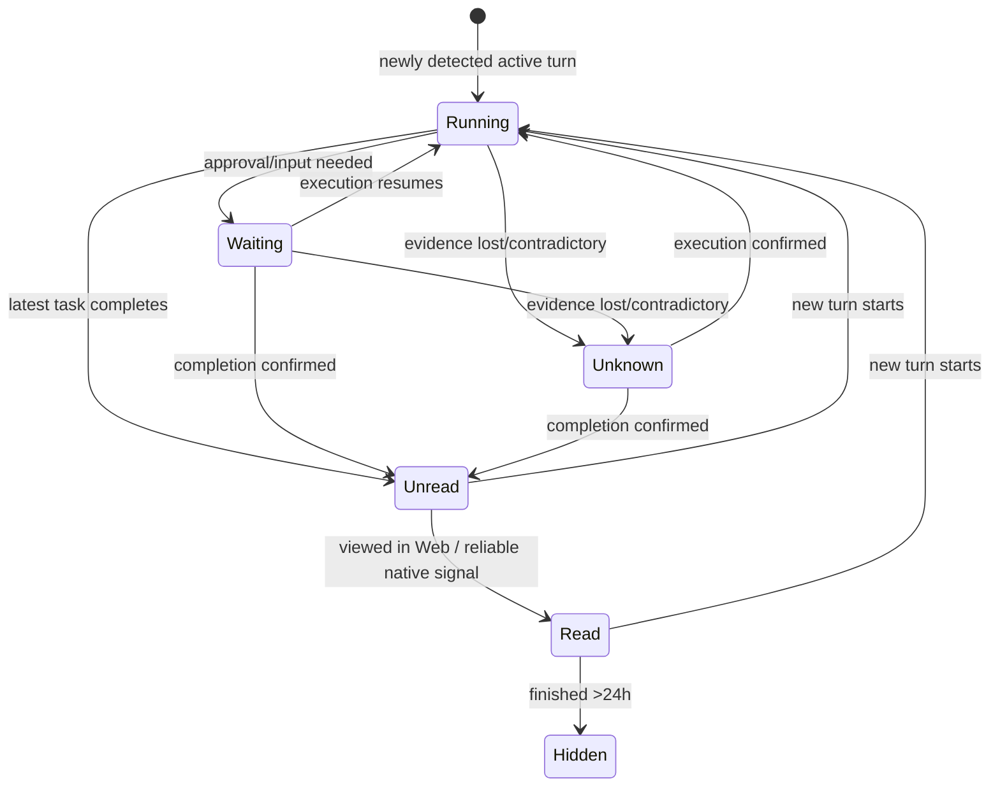
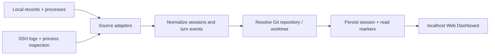

# Coding Agent Activity Dashboard — Human Spec

> **Version:** 1.0 (MVP scope frozen)  
> **Date:** 2026-10-21  
> **Status:** Requirements confirmed; implementation and data-source feasibility not yet verified  
> **Audience:** Human reviewer, implementation engineer, coding agent

## 1. Product intent

Build a **local, read-only Web Dashboard** that automatically discovers and monitors existing **Codex CLI, Cursor CLI (`cursor-agent`), and Cursor IDE Agent/Composer** sessions across the local computer and SSH-accessible development hosts.

A user configures their machines once, then can answer at a glance:

1. Which agents are executing work?
2. Which agents are waiting for human intervention?
3. Which agents finished and have not been checked?

**Guiding principles:** zero change to existing agent workflows; minimal setup; project-first presentation; avoid false state certainty.

## 2. Frozen MVP scope

| Area | Requirement |
|---|---|
| Agent sources | Codex CLI, Cursor CLI, Cursor IDE Agent/Composer |
| Hosts | Auto-discover local sessions; scan configured SSH remote hosts |
| Integration | Pull-based read-only collection; no software required on remote hosts |
| SSH configuration | Import/reuse `~/.ssh/config`, plus add/remove/select hosts in Web UI |
| Deployment | Run Web service locally, accessible via `localhost` only by default |
| Projects | Identify by Git repository; merge sessions across hosts and Git worktrees |
| Non-Git folders | Fallback to working-directory identity |
| Project activity | Latest actual Agent activity, not Git commits or file modifications |
| Project visibility | Show projects with Agent activity during the last rolling 7 days |
| Project ordering | Most recently active first |
| Session granularity | One card per native Agent session; latest turn/task only |
| Session states | Running, Waiting, Unread, Read, Unknown |
| Session ordering | Waiting → Unread → Running → Read; sort by most recent activity within each state. Unknown must remain visible, with position to be decided during UI implementation. |
| Refresh | Poll every 15 seconds; offer manual refresh |
| Details | Latest user instruction, final Agent response, task duration, working directory, source tool; show source host and Git branch/worktree when known |
| Read semantics | Opening the card in the Web UI marks it read; detect viewing in native tools **best effort** |
| Automatic hiding | Hide a finished **Read** session when its latest task finished more than 24 hours ago |
| First import | All historically completed tasks start as Read; historically running sessions continue being monitored |
| Offline hosts | Preserve last sample and display Offline; never present cached Running as a verified live state |
| Notifications | None in MVP |

## 3. Definitions and identity

### 3.1 Project

A Project is a logical Git repository, even when the repo is cloned on multiple hosts or has multiple worktrees. Sessions are listed within their Project.

- Resolve a worktree to its parent/common Git repository.
- Compare normalized Git repository identities across hosts (e.g., SSH/HTTPS forms of the same origin) **where reliably possible**.
- If a repository has no remote or its identity is ambiguous, **do not silently merge unrelated projects**. Use a stable fallback identity and surface ambiguity if needed.
- For a directory without Git metadata, use its working directory, namespaced by host, to avoid collisions.

**Implementation detail, not a newly agreed product feature:** the exact repository-key algorithm needs PoC validation.

### 3.2 Session

A Session is one native Codex/Cursor conversation or CLI session, with a stable identity that includes the source tool and originating host (or native source namespace). Multiple turns within a session **do not create separate cards**.

- The card reflects **only the newest turn/task**.
- If an Unread or Read session starts a new turn, it becomes Running; older unread turns are **not separately tracked**.
- Session details expose the newest task, not full history.

### 3.3 Agent activity time

Project activity is the timestamp of the latest **Agent execution activity** observed for any session in that project. Do not count opening the Web UI, marking a card Read, editing files manually, or Git commits as Agent activity.

The visibility window is **rolling 7 days**, evaluated from local current time. Sort projects descending by latest Agent activity.

## 4. State model

| State | Meaning | Trigger / evidence |
|---|---|---|
| **Running** | Latest task is actively executing | Native task-start / continued-execution evidence; **process presence alone is insufficient** |
| **Waiting** | Agent needs human input/approval to proceed | Supported native waiting/approval evidence; classification may be unavailable for some source versions |
| **Unread** | Latest task finished and has not been viewed | Native task-complete evidence after tracking began (or a new task in a previously tracked session) |
| **Read** | Latest finished task was viewed | Web card opened; native-tool view detection only when evidence is reliable; history imported as Read |
| **Unknown** | Task state cannot be determined reliably | Process vanished, incomplete logs, unsupported events, conflicting signals, etc. |

**Offline** is a separate **source freshness/host connectivity marker**, not a sixth task outcome. Preserve the most recent known session data but do not claim a stale state is current.

### 4.1 Transitions

When a new turn starts, reset the latest-turn read status. A task that finishes after tracking starts becomes Unread even if the session itself predates installation.

### 4.2 Hiding and filtering

A session may be excluded from the main view when:

1. Its **Project** has no Agent activity in the latest 7 days; **or**
2. The session is **Read** and the latest task's completion time is **more than 24 hours in the past**.

The 24-hour timer begins **at completion**, not when viewed. Unread sessions are **not** hidden by the 24-hour rule, but their project still has to meet the 7-day activity requirement.

**Initial scan:** treat historical completed turns as Read; those older than 24 hours naturally disappear under the same rule. Do not generate a backlog of historical unread reminders.

**State confidence rule:** Never infer a completed task merely because an Agent process exited; classify Unknown unless sufficient terminal-event evidence exists.

## 5. Web UX

### 5.1 Main screen — project-first collapsible list

- Each project is a collapsible row, ordered by last Agent activity (descending).
- Collapsed row shows project name and Waiting / Unread / Running counts. Unknown must be visually discoverable, not silently lost; additional status counts are allowed if unobtrusive.
- Expanded row shows session cards, ordered **Waiting → Unread → Running → Read**, with newest activity first within the same status.
- Card shows task title or excerpt, state, source tool, source host, last activity, and (when available) branch/worktree.
- Unknown cards show why confidence is insufficient.
- Host Offline is plainly indicated on affected cards/counts; cached data must be distinguishable from current data.

### 5.2 Session detail

Clicking a session opens a lightweight detail view with:

- Latest user's instruction
- Latest Agent final response (if available)
- Latest turn/task duration
- Source tool, host, working directory
- Git branch/worktree where known
- Completion time / current status as available

Clicking/opening a completed card **marks it Read**, and the read marker persists across Web service restarts. It does **not** need to open the original Codex/Cursor application. Full chat-history browsing is explicitly out of scope.

### 5.3 Host settings

- List SSH entries imported from local `~/.ssh/config`.
- Allow adding/removing/selecting monitor targets via Web UI, reusing SSH keys/ProxyJump options where available.
- Avoid persisting SSH passwords or duplicating private-key material.
- Monitor localhost automatically.
- Make scan failures visible without preventing healthy hosts from updating.

## 6. Collection and normalization contract

The Dashboard is **read-only** and must not require users to launch Agents through a new wrapper or change their usual IDE/terminal setup.

**Suggested processing pipeline (technical proposal, not frozen implementation):**

Each source adapter should supply, to the extent evidence permits:

- `source_type` (`codex_cli`, `cursor_cli`, `cursor_ide`)
- `host_id`, `native_session_id`, `working_directory`
- Git repository identity, branch and worktree if discoverable
- Latest task start, activity and completion timestamps
- Latest user prompt and final Agent response
- Evidence for active execution, approval waiting and explicit terminal outcome
- Raw source timestamp / collection timestamp / confidence or reason for Unknown

**Key source risk:** Cursor IDE conversation/state storage can live on the **local desktop** even when editing a Remote-SSH workspace. The prototype must verify how to associate those sessions with the correct remote workspace and project without assuming all data lives on the remote host.

**State events are version-dependent.** Do not assume CLI and IDE formats provide equivalent Waiting, Read, or completion signals. Unsupported capabilities must degrade to Unknown / Web-only Read, with no fabricated precision.

## 7. Refresh, persistence, and failure behavior

- Every **15 seconds**, perform scheduled scans of local and configured SSH sources.
- Provide an explicit **Refresh now** action.
- Prevent overlapping scans of a still-running target.
- Scan hosts independently so an unreachable host does not delay other results.
- Track scan freshness and maintain cached records through temporary disconnects.
- Persist source configuration, stable session identity, latest task state/evidence, completion time and Web Read markers locally so restarts do not lose state.
- Localhost-only network binding by default. SSH credentials and captured prompts/responses are sensitive; do not expose publicly or add telemetry to MVP.

The persistence engine, framework, database and polling implementation are **not mandated** by this human spec. Favor low maintenance and no external database service.

## 8. Explicit non-goals

- Launching Agents, steering them, sending prompts or approving commands
- Replacing Codex/Cursor interfaces
- A complete searchable session-history viewer
- Per-turn unread inbox or notifications for older turns
- Browser/system/Feishu notifications
- Cloud-hosted or shared multi-user service
- Mandatory remote collectors, hooks, IDE extensions or wrapper CLIs
- Git/file-activity project ranking
- Guaranteeing native-tool Read or Waiting detection where data sources expose no reliable events

## 9. Acceptance criteria (MVP)

1. **Simple setup:** with a configured SSH key, user can select/add a remote host in the UI and view sessions without installing a remote agent.
2. **Source coverage:** prototype discovers local and remote Codex CLI, Cursor CLI and Cursor IDE sessions where data is accessible; documented limitations are surfaced, not silently claimed supported.
3. **Project grouping:** same repository across hosts and worktrees groups under one project when the identity is unambiguous; unrelated directories are not incorrectly merged.
4. **Activity filter:** only projects with Agent activity in the rolling previous 7 days appear, newest first.
5. **Session behavior:** one card per session, reflecting only its newest task; next-turn start resets status appropriately.
6. **Task state:** Running is not inferred from an idle open CLI process; confirmed completion becomes Unread; uncertain and crashed sessions do not yield false completion claims.
7. **Human attention:** reliably detectable Waiting events take priority; unsupported Waiting events degrade gracefully.
8. **Read and hide:** Web click marks Read and survives restart; Read + completion older than 24 hours is hidden; Unread is kept while its project qualifies.
9. **Historical import:** old completed tasks are Read on first scan, not newly Unread; older running sessions remain monitored.
10. **Detail pane:** latest user instruction, final answer, duration, source and working directory appear when available.
11. **Polling:** updates on a 15-second schedule, manual refresh works, one host's failure does not block the others.
12. **Offline:** unavailable hosts retain cached data with explicit Offline/stale indicators, without falsely presenting live Running.
13. **Safety:** collection is read-only; no required hooks, plugins, remote binaries, or modifications to Codex/Cursor state.

## 10. Feasibility gate before UI development

Implement a small **Data Collection PoC** against real representative installations, verifying each of the following for the three sources separately:

- Session discovery; stable session identity; local/remote path resolution
- New-turn start and progress signals; explicit finish events; abrupt termination
- Waiting for approval/input (if observable)
- Native view/read event (if observable); otherwise confirm Web-only fallback
- Latest prompt / final response / duration extraction
- Git repository and worktree resolution; IDE Remote-SSH data location
- Performance and permission implications of 15-second SSH polling

**Pass condition:** each source provides enough reliable evidence for its supported statuses, or limitations are clearly documented and degrade according to the state model. No source should be presented as fully supported based solely on assumptions about log formats.

## 11. Decision record

These choices were explicitly made in the scope-setting chat:

1. Support Cursor CLI **and** Cursor IDE (in addition to Codex CLI).
2. Count Web views and, best-effort, native-tool views as Read.
3. SSH Pull, not mandatory host agents.
4. Git repository grouping, not only working-directory grouping.
5. Session-level cards, not task-level cards.
6. Execution-event state detection, not process-exists detection.
7. Waiting is a separate state.
8. Hide Read after **24 hours from task completion**.
9. Project activity is Agent activity only.
10. Support SSH Config and Web host settings.
11. Run Web service on the local workstation.
12. Poll every 15 seconds.
13. Show latest task/result, not entire chat history.
14. Native-tool read integration is best effort.
15. Include both local and SSH remote sessions.
16. Retain offline host cache, clearly marked.
17. Order sessions by attention priority.
18. Include Unknown for uncertain state.
19. Use a project collapsible list.
20. Import historical completed sessions as Read.
21. No proactive notifications in MVP.
22. Group Git worktrees under the same repository.
23. New task replaces the previous task's unread indicator.
24. Freeze MVP scope; proceed to feasibility PoC and implementation planning.

---

**Implementation discipline:** preserve the frozen scope. Treat unverified native data-source behavior as a research task and surface uncertainties instead of silently changing product semantics.
